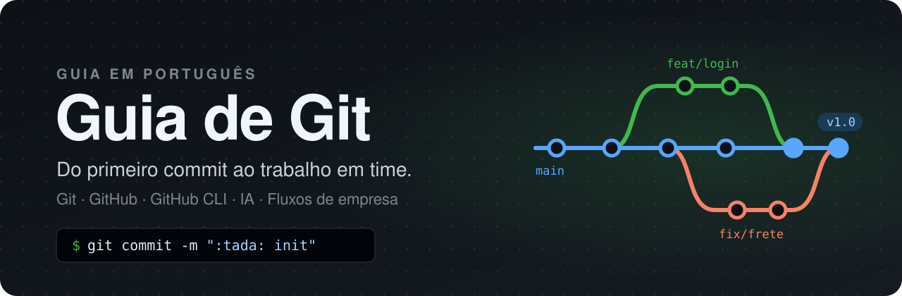
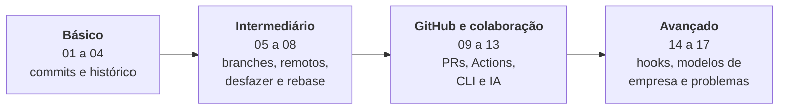

<p align="center">
  
</p>

<p align="center">
  
  
  
  
</p>

<p align="center">
  <a href="docs/01-o-que-e-git.md"><b>Começar</b></a> ·
  <a href="#trilha">Trilha</a> ·
  <a href="docs/cola.md">Cola de comandos</a> ·
  <a href="docs/17-problemas-comuns.md">Problemas comuns</a>
</p>

---

## Sobre

Git é a ferramenta que todo desenvolvedor usa todos os dias, mas a maioria aprende na marra: decora `add`, `commit` e `push` e entra em pânico no primeiro conflito.

Este guia ensina Git e GitHub **do jeito que se usa de verdade**, em ordem e sem enrolação. Começa pelo primeiro `git init` e vai até o que as empresas esperam de você: pull requests, code review, automação com GitHub Actions, fluxos de trabalho como Git Flow e trunk-based, e o uso do GitHub CLI junto com ferramentas de IA.

Tudo em português, com exemplos para rodar no terminal, diagramas e ferramentas prontas para manter seus commits no padrão.

## Para quem é

- **Quem está começando** e quer aprender do jeito certo desde o início.
- **Quem já usa Git**, mas trava com conflito, rebase ou "como eu desfaço isso?".
- **Quem vai trabalhar em time** e precisa entender pull request, code review e fluxos de branch.
- **Quem usa IA no terminal** (Claude Code, GitHub Copilot CLI, Codex...) e quer entender o que o agente faz com o `git` e o `gh`.

## O que você vai aprender

- Como o Git funciona por dentro: as três áreas, commits, branches e o `HEAD`.
- Escrever commits claros com **Conventional Commits** e validar isso automaticamente.
- Trabalhar com branches, resolver conflitos e escolher entre merge e rebase.
- **Desfazer qualquer coisa** com segurança: `restore`, `reset`, `revert` e `reflog`.
- Colaborar no GitHub: fork, pull request, issues, Projects e code review.
- Automatizar testes e deploys com **GitHub Actions**.
- Fazer tudo pelo terminal com o **GitHub CLI** e usar o `gh` junto com agentes de IA.
- Como as empresas organizam o trabalho: **Git Flow, GitHub Flow, GitLab Flow e trunk-based**.
- Ferramentas avançadas: `bisect`, `worktree`, submódulos, Git LFS e hooks.

## Como o guia está organizado

São 17 capítulos em quatro blocos. Cada bloco assume que você conhece o anterior. A cola de comandos e o glossário servem de consulta a qualquer momento.



## Trilha

### Básico

| # | Capítulo | O que você aprende |
| --- | --- | --- |
| 01 | [O que é Git](docs/01-o-que-e-git.md) | Controle de versão, Git x GitHub, as três áreas |
| 02 | [Instalação e configuração](docs/02-instalacao-e-configuracao.md) | Instalar, configurar nome, e-mail e editor |
| 03 | [Primeiros passos](docs/03-primeiros-passos.md) | `init`, `status`, `add`, `commit`, `log`, `diff` |
| 04 | [Padrões de commit](docs/04-padroes-de-commit.md) | Conventional Commits, tipos, emojis e boas mensagens |

### Intermediário

| # | Capítulo | O que você aprende |
| --- | --- | --- |
| 05 | [Branches e merge](docs/05-branches-e-merge.md) | Criar e trocar branches, merge e conflitos |
| 06 | [Repositórios remotos](docs/06-repositorios-remotos.md) | SSH, `clone`, `push`, `pull`, `fetch` |
| 07 | [Desfazendo coisas](docs/07-desfazendo-coisas.md) | `restore`, `amend`, `reset`, `revert`, `reflog` |
| 08 | [Stash, rebase e cherry-pick](docs/08-stash-rebase-cherry-pick.md) | Guardar trabalho, reescrever histórico, tags |

### GitHub e colaboração

| # | Capítulo | O que você aprende |
| --- | --- | --- |
| 09 | [GitHub na prática](docs/09-github-na-pratica.md) | Perfil, README, issues, Projects, fork, pull request, code review |
| 10 | [Fluxos de trabalho](docs/10-fluxos-de-trabalho.md) | GitHub Flow, Git Flow, nomes de branch, trabalho em time |
| 11 | [GitHub Actions](docs/11-github-actions.md) | Automação: testes a cada push, segredos, artefatos |
| 12 | [Recursos do GitHub](docs/12-recursos-do-github.md) | Pages, Releases, Gists, segurança, Codespaces, API |
| 13 | [GitHub CLI (`gh`) e IA](docs/13-github-cli.md) | Issues, PRs e Actions pelo terminal, `--json`, e como agentes de IA usam o `gh` |

### Avançado

| # | Capítulo | O que você aprende |
| --- | --- | --- |
| 14 | [.gitignore e hooks](docs/14-gitignore-e-hooks.md) | Ignorar arquivos e automatizar validações |
| 15 | [Git avançado](docs/15-git-avancado.md) | bisect, worktree, submódulos, LFS, patches, reescrever histórico |
| 16 | [Modelos de trabalho nas empresas](docs/16-modelos-de-trabalho.md) | Git Flow, GitHub Flow, GitLab Flow, trunk-based, feature flags e governança |
| 17 | [Problemas comuns](docs/17-problemas-comuns.md) | "Commitei na branch errada", senha no commit, push recusado... |

### Referência

- [Cola de comandos](docs/cola.md): os comandos mais usados em uma página
- [Glossário](docs/glossario.md): os termos do Git explicados em uma linha

## Por onde começar

| Se você... | Comece por |
| --- | --- |
| Nunca usou Git | [01. O que é Git](docs/01-o-que-e-git.md) e siga em ordem |
| Já usa, mas quer organizar o conhecimento | [04. Padrões de commit](docs/04-padroes-de-commit.md) e [05. Branches e merge](docs/05-branches-e-merge.md) |
| Vai começar a trabalhar em time | [09. GitHub na prática](docs/09-github-na-pratica.md) e [16. Modelos de trabalho](docs/16-modelos-de-trabalho.md) |
| Usa IA para programar | [13. GitHub CLI e IA](docs/13-github-cli.md) |
| Está com um problema agora | [17. Problemas comuns](docs/17-problemas-comuns.md) |

## Como estudar

- **Aprenda fazendo.** Abra um terminal, crie uma pasta de teste e repita os comandos de cada capítulo. Vários capítulos terminam com um exercício.
- **Não tenha medo de errar.** Num repositório de teste nada se perde, e o capítulo 07 ensina a desfazer quase tudo.
- **Use os diagramas.** Branches, merges e fluxos estão desenhados para você ver o que cada comando faz com o histórico.
- **Acompanhe com o roadmap.** Os capítulos cobrem os tópicos do [roadmap de Git e GitHub do roadmap.sh](https://roadmap.sh/git-github). Use os dois juntos para marcar seu progresso.

## Ferramentas incluídas

A pasta [`scripts/`](scripts) traz duas ferramentas para manter seus commits no padrão do [capítulo 04](docs/04-padroes-de-commit.md):

| Script | O que faz |
| --- | --- |
| [`install.sh`](scripts/install.sh) | Instala um hook que recusa commits fora do padrão, em um projeto ou em todos |
| [`commit.sh`](scripts/commit.sh) | Assistente interativo que monta a mensagem de commit para você |

```bash
git clone https://github.com/karlos-silva/guia-git.git
./guia-git/scripts/install.sh caminho/do/seu-projeto
```

Detalhes no capítulo [.gitignore e hooks](docs/14-gitignore-e-hooks.md#hooks-deste-repositório).

## Encontrou um erro?

Abra uma [issue](https://github.com/karlos-silva/guia-git/issues) ou mande um pull request. Sugestões de tópicos também são bem-vindas.

## Licença

[MIT](LICENSE). Use, copie e adapte à vontade.
