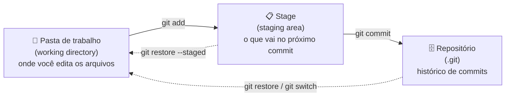

# 01. O que é Git

## O problema

Sem controle de versão, a pasta do projeto acaba assim:

```text
trabalho.py
trabalho-v2.py
trabalho-v2-final.py
trabalho-v2-final-AGORA-VAI.py
```

E ainda sobram as perguntas: o que mudou entre uma versão e outra? Quem mudou? Dá pra voltar para a versão de ontem? Como duas pessoas mexem no mesmo arquivo sem uma apagar o trabalho da outra?

## O que o Git faz

Git é um **sistema de controle de versão**. Ele guarda o histórico do seu projeto em "fotos" chamadas **commits**. Cada commit registra:

- como os arquivos estavam naquele momento;
- quem fez e quando;
- uma mensagem explicando o que mudou;
- um identificador único (o **hash**, tipo `a1b2c3d`).

Com isso você pode voltar a qualquer ponto, comparar versões, trabalhar em várias ideias ao mesmo tempo (branches) e juntar o trabalho de várias pessoas.

O Git é **distribuído**: cada cópia do repositório tem o histórico completo. Você commita offline, no seu computador, e só sincroniza quando quiser.

### Git x outros sistemas

Antes do Git, eram comuns sistemas **centralizados** como SVN e CVS: o histórico ficava só no servidor, e sem conexão não dava para commitar. Também existem outros distribuídos, como Mercurial. O Git, criado em 2005 por Linus Torvalds para o kernel do Linux, venceu por ser rápido, ter branches baratas e funcionar offline. Hoje é o padrão de mercado.

## Git x GitHub

São coisas diferentes:

| Git | GitHub |
| --- | --- |
| Programa que roda no seu computador | Site que hospeda repositórios Git |
| Controla o histórico | Guarda uma cópia online e adiciona colaboração |
| Funciona sem internet | Precisa de internet |
| Comandos no terminal | Pull requests, issues, Actions, Pages... |

Alternativas ao GitHub: GitLab, Bitbucket, Gitea. O Git é o mesmo em todos.

## As três áreas

Esse é o conceito mais importante do Git. Todo arquivo passa por três lugares:



1. **Pasta de trabalho:** seus arquivos, do jeito que estão agora.
2. **Stage:** uma "sala de espera". Você escolhe com `git add` o que vai no próximo commit.
3. **Repositório:** o histórico salvo, dentro da pasta oculta `.git`.

O stage existe para você montar commits caprichados: mexeu em cinco arquivos, mas só três tratam do mesmo assunto? Adiciona esses três, commita, e depois cuida dos outros.

## Estados de um arquivo

| Estado | Significa |
| --- | --- |
| **untracked** | Arquivo novo, o Git ainda não acompanha |
| **modified** | Mudou desde o último commit, mas não está no stage |
| **staged** | Está no stage, vai entrar no próximo commit |
| **committed** | Salvo no histórico, sem mudanças pendentes |

O `git status` mostra em que estado cada arquivo está. Você vai usar muito.

## Resumo

- Git guarda o histórico do projeto em commits.
- GitHub é um lugar para hospedar repositórios Git.
- Fluxo básico: editar → `git add` → `git commit`.

---

[Índice](../README.md) · [Próximo: Instalação e configuração →](02-instalacao-e-configuracao.md)
