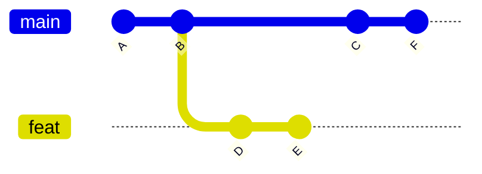
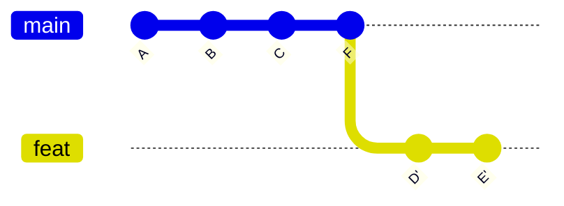

# 08. Stash, rebase e cherry-pick

## Stash

Está no meio de uma mudança e precisa trocar de branch para corrigir algo urgente? O `stash` guarda suas mudanças numa "gaveta" e deixa a pasta limpa.

```bash
git stash                         # guarda
git stash -u                      # guarda incluindo arquivos novos (untracked)
git stash push -m "form pela metade"   # guarda com um nome
git stash list                    # lista o que está guardado
git stash pop                     # traz de volta o último e remove da lista
git stash apply stash@{1}         # traz um específico, sem remover
git stash drop stash@{1}          # apaga um da lista
```

Fluxo típico:

```bash
git stash -u
git switch main
# ... corrige o bug, commita, push ...
git switch feat/formulario
git stash pop
```

## Rebase

O `rebase` pega os commits da sua branch e **reaplica em cima** de outra. O resultado é um histórico em linha reta, sem commits de merge.

Antes: a `feat` saiu do `B`, e a `main` andou depois disso.



Depois de `git switch feat && git rebase main`: os commits da `feat` passam a sair do `F`.



Os commits `D'` e `E'` são **novos** (hash diferente), com o mesmo conteúdo de `D` e `E`.

```bash
git switch feat/login
git rebase main
```

Se der conflito, resolva como no merge e continue:

```bash
git add arquivo-resolvido
git rebase --continue
# ou desista:
git rebase --abort
```

### Merge ou rebase?

| | Merge | Rebase |
| --- | --- | --- |
| Histórico | Mostra exatamente o que aconteceu, com bifurcações | Linha reta, mais fácil de ler |
| Reescreve commits? | Não | Sim |
| Seguro em branch compartilhada? | Sim | **Não** |

Regra prática: **rebase na sua branch local** para atualizá-la com a `main`; **merge (ou pull request)** para levar a branch para a `main`.

Depois de um rebase em uma branch que já estava no GitHub, o push precisa de força:

```bash
git push --force-with-lease
```

O `--force-with-lease` recusa o push se alguém tiver enviado algo que você ainda não viu. Nunca use `--force` puro.

## Rebase interativo

Serve para arrumar seus commits **antes** de enviar: juntar, reordenar, renomear ou apagar.

```bash
git rebase -i HEAD~4    # mexe nos 4 últimos commits
```

O editor abre com a lista:

```text
pick a1b2c3d feat: adiciona formulário
pick d4e5f6a wip
pick 7a8b9c0 wip de novo
pick 1d2e3f4 fix: typo
```

Troque a palavra do começo de cada linha:

| Comando | Efeito |
| --- | --- |
| `pick` | Mantém o commit |
| `reword` | Mantém, mas deixa mudar a mensagem |
| `squash` | Junta com o commit de cima e combina as mensagens |
| `fixup` | Junta com o de cima e descarta a mensagem |
| `drop` | Apaga o commit |

Exemplo: juntar os "wip" no primeiro commit:

```text
pick a1b2c3d feat: adiciona formulário
fixup d4e5f6a wip
fixup 7a8b9c0 wip de novo
fixup 1d2e3f4 fix: typo
```

Salve e feche. Os quatro viram um commit só, com uma mensagem limpa.

## Cherry-pick

Copia **um commit específico** de outra branch para a atual.

```bash
git switch main
git cherry-pick a1b2c3d
```

Útil quando uma correção foi feita numa branch de feature e precisa ir para a `main` antes do resto. Use com moderação: o mesmo conteúdo fica em dois commits diferentes.

## Tags

Tags marcam versões importantes (lançamentos).

```bash
git tag                                # lista
git tag -a v1.0.0 -m "Primeira versão"  # cria uma tag anotada
git push origin v1.0.0                 # envia uma tag
git push --tags                        # envia todas
git tag -d v1.0.0                      # apaga local
```

O padrão de nomes mais comum é o [versionamento semântico](https://semver.org/lang/pt-BR/): `MAIOR.MENOR.CORREÇÃO`. Um `feat` sobe o MENOR, um `fix` sobe a CORREÇÃO, e uma quebra de compatibilidade (`!`) sobe o MAIOR.

---

[← Anterior](07-desfazendo-coisas.md) · [Índice](../README.md) · [Próximo: GitHub na prática →](09-github-na-pratica.md)
