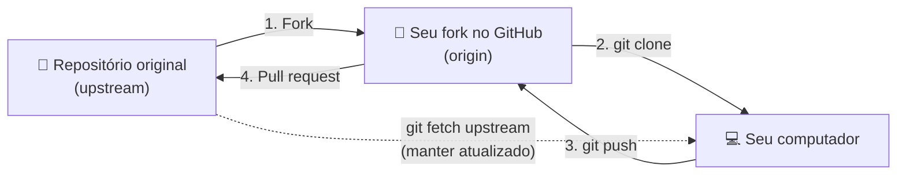

# 09. GitHub na prática

## Conta e perfil

1. Crie a conta em [github.com](https://github.com) e ative a **autenticação em dois fatores** (*Settings → Password and authentication*).
2. Coloque foto, nome e uma bio curta.
3. Crie o **README de perfil**: um repositório com **o mesmo nome do seu usuário** (ex.: `karlos-silva/karlos-silva`). O `README.md` dele aparece no topo do seu perfil. Use para dizer quem você é, o que estuda e onde estão seus melhores projetos.
4. **Fixe** (*Customize your pins*) até 6 repositórios que você quer mostrar.

Estudante? O [GitHub Education](https://education.github.com) dá o **Student Developer Pack**, com Copilot, domínios e créditos em várias ferramentas, de graça.

## Repositórios

Ao criar (*New repository*):

- **Público ou privado.** Público qualquer um vê. Privado só você e quem você convidar. Dá para trocar depois em *Settings*.
- **README, .gitignore e licença.** Marque se o projeto ainda não existe no seu computador. Se já existe, crie vazio (veja o [capítulo 06](06-repositorios-remotos.md#enviando-um-projeto-local-para-o-github)).

### Um bom README

O README é a porta de entrada do projeto. Responda:

1. **O que é** e para que serve (uma frase + um print ou GIF).
2. **Como rodar** (pré-requisitos e comandos).
3. **Como usar** (exemplos).
4. **Tecnologias** usadas.
5. **Como contribuir** e **licença**.

### Markdown em 30 segundos

````markdown
# Título        ## Subtítulo        ### Seção

**negrito**  *itálico*  ~~riscado~~  `código`

- lista
1. lista numerada
- [ ] tarefa   - [x] tarefa feita

[link](https://exemplo.com)


> citação

```js
console.log("bloco de código com destaque");
```

| coluna | coluna |
| --- | --- |
| valor | valor |
````

O GitHub também entende alertas (`> [!NOTE]`, `> [!WARNING]`), diagramas [Mermaid](https://mermaid.js.org) e emojis (`:rocket:`).

### Arquivos especiais

| Arquivo | Para que serve |
| --- | --- |
| `README.md` | Apresentação do projeto |
| `LICENSE` | Diz o que outras pessoas podem fazer com o código. Sem licença, ninguém pode reutilizar legalmente |
| `CONTRIBUTING.md` | Regras para contribuir (padrão de commit, como rodar testes) |
| `CODE_OF_CONDUCT.md` | Código de conduta da comunidade |
| `SECURITY.md` | Como reportar vulnerabilidades |
| `.github/ISSUE_TEMPLATE/` | Modelos de issue |
| `.github/pull_request_template.md` | Modelo de descrição de PR |
| `CITATION.cff` | Como citar o projeto (pesquisa acadêmica) |

## Issues

Issues são a lista de tarefas do projeto: bugs, ideias, dúvidas.

Uma boa issue de bug tem:

- o que aconteceu x o que deveria acontecer;
- passo a passo para reproduzir;
- ambiente (sistema, navegador, versão);
- print ou log do erro.

Recursos úteis:

- **Labels:** classificam (`bug`, `enhancement`, `good first issue`, `documentation`).
- **Assignees:** quem vai resolver.
- **Milestones:** agrupam issues de uma entrega ou versão.
- **Menções:** `@usuario` notifica a pessoa, `#42` linka a issue ou PR 42.
- **Reações:** 👍 em vez de comentar "+1".
- **Saved replies:** respostas prontas para mensagens que você repete.

### Fechando issues pelo commit ou PR

Escreva no commit ou na descrição do PR:

```text
Closes #42
Fixes #42
Resolves #42
```

Quando o PR entra na branch principal, a issue fecha sozinha.

## GitHub Projects

Quadro estilo Kanban (*A fazer → Fazendo → Feito*) ligado às issues e PRs. Bom para planejar sprints, trabalhos da faculdade em grupo ou um roadmap pessoal. Crie em *Projects → New project*.

## Pull requests

Um **pull request (PR)** é um pedido para juntar uma branch em outra, com espaço para revisão e discussão antes do merge.

### Fluxo em um repositório seu (ou do time)

```bash
git switch -c feat/busca
# ... commits ...
git push -u origin feat/busca
```

No GitHub aparece o botão **Compare & pull request**. Ou pelo terminal, com o [GitHub CLI](13-github-cli.md):

```bash
gh pr create --fill
```

### Contribuindo com projeto de outra pessoa (fork)

Você não tem permissão para criar branches no repositório dos outros. Então:

| | Clone | Fork |
| --- | --- | --- |
| O que é | Cópia no seu computador | Cópia na **sua conta do GitHub** |
| Para quê | Trabalhar localmente | Propor mudanças em projetos onde você não tem acesso de escrita |



1. Clique em **Fork** no repositório original.
2. Clone **o seu fork**:

   ```bash
   git clone git@github.com:seu-usuario/projeto.git
   cd projeto
   git remote add upstream git@github.com:dono-original/projeto.git
   ```

3. Crie uma branch, commite e envie para o seu fork:

   ```bash
   git switch -c fix/typo-readme
   git commit -am "docs: corrige erro de digitação no README"
   git push -u origin fix/typo-readme
   ```

4. No GitHub, abra o PR do seu fork para o original.

Para manter o fork atualizado:

```bash
git switch main
git fetch upstream
git merge upstream/main
git push
```

> Procurando onde contribuir pela primeira vez? Busque issues com a label `good first issue`.

### Um bom PR

- **Pequeno e focado:** uma coisa por PR. PR de 2.000 linhas ninguém revisa direito.
- **Título claro**, no mesmo padrão dos commits.
- **Descrição** com o que muda, por que muda e como testar. Prints ajudam muito em mudanças visuais.
- **Linke a issue** (`Closes #42`).
- **Revise você mesmo** a aba *Files changed* antes de pedir revisão.
- Use **Draft** se ainda não estiver pronto.

### Code review

Quem revisa pode **comentar**, **aprovar** ou **pedir mudanças**, inclusive sugerindo código direto na linha (*Add a suggestion*).

Dicas para revisar bem:

- Comente o código, não a pessoa. "Essa função pode quebrar se a lista vier vazia" em vez de "você esqueceu...".
- Diferencie o que é obrigatório do que é sugestão (`nit:` para detalhes).
- Elogie o que ficou bom.

### Formas de merge do PR

| Opção | Resultado |
| --- | --- |
| **Create a merge commit** | Todos os commits + um commit de merge |
| **Squash and merge** | Todos os commits viram **um só** na branch principal. O mais usado em times |
| **Rebase and merge** | Commits reaplicados em linha reta, sem commit de merge |

Depois do merge, apague a branch (o GitHub oferece um botão).

## Trabalhando em grupo

- **Colaboradores:** em repositório pessoal, *Settings → Collaborators* dá acesso de escrita para outras pessoas. Ideal para trabalho de faculdade.
- **Organizações:** contas compartilhadas para times e empresas, com repositórios da organização, **teams** (grupos de pessoas) e permissões por time (*read*, *triage*, *write*, *maintain*, *admin*).
- **Proteção de branch:** em *Settings → Branches* (ou *Rules*) dá para exigir PR, revisão aprovada e testes passando antes de qualquer merge na `main`.

---

[← Anterior](08-stash-rebase-cherry-pick.md) · [Índice](../README.md) · [Próximo: Fluxos de trabalho →](10-fluxos-de-trabalho.md)
