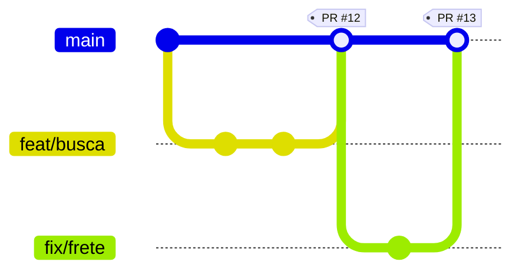

# 10. Fluxos de trabalho

Um **fluxo de trabalho** (workflow) é o combinado do time sobre como usar branches, quando fazer merge e como lançar versões. Não existe um certo: existe o que combina com o tamanho do time e a frequência de entrega.

> Este capítulo é a introdução. Para ver cada modelo a fundo (comandos de cada etapa, feature flags, governança e como as empresas escolhem), veja [Modelos de trabalho nas empresas](16-modelos-de-trabalho.md).

## GitHub Flow (recomendado para começar)

Simples e suficiente para a maioria dos projetos:



1. A `main` está **sempre funcionando** e pronta para ir ao ar.
2. Para qualquer mudança, crie uma branch a partir da `main`.
3. Commite e envie a branch.
4. Abra um pull request e peça revisão.
5. Revisado e com os testes passando, faça o merge.
6. Faça o deploy e apague a branch.

## Git Flow

Mais estruturado, com branches de longa duração:

| Branch | Função |
| --- | --- |
| `main` | Só versões lançadas |
| `develop` | Integração do que vai entrar na próxima versão |
| `feature/*` | Novos recursos, saem e voltam para `develop` |
| `release/*` | Preparação de uma versão (ajustes finais) |
| `hotfix/*` | Correção urgente, sai da `main` e volta para `main` e `develop` |

Faz sentido para software com versões planejadas (apps de loja, bibliotecas). Para sites e sistemas web com deploy contínuo, costuma ser burocrático demais.

## Trunk-based development

Todo mundo integra na `main` (o "tronco") várias vezes ao dia, com branches que duram horas. Recursos incompletos ficam escondidos por *feature flags*. Exige testes automatizados fortes e é comum em times experientes.

## Histórico linear x não linear

| | Linear | Não linear |
| --- | --- | --- |
| Como fica | Uma linha reta de commits | Bifurcações e commits de merge |
| Como obter | Rebase, squash and merge | Merge commit |
| Vantagem | Fácil de ler e de usar `git bisect` | Mostra exatamente como o trabalho aconteceu |

Muitos times usam **squash and merge** nos PRs: a `main` fica linear, com um commit por PR, e o detalhe dos commits continua no PR.

## Nomes de branch

Use um prefixo com o tipo, igual aos commits:

```text
feat/login-com-google
fix/calculo-de-frete
docs/guia-de-instalacao
refactor/servico-de-pagamento
chore/atualiza-dependencias
```

Com número de issue ou card:

```text
feat/123-login-com-google
```

Regras: tudo minúsculo, palavras separadas por hífen, sem acento, sem espaço e curto.

## Combinados para trabalhar em time

- Ninguém commita direto na `main`: tudo passa por PR (use proteção de branch).
- Atualize sua branch com a `main` com frequência para evitar conflitos grandes.
- PRs pequenos, revisados em até um dia.
- Padrão de commit combinado e validado ([capítulo 04](04-padroes-de-commit.md)).
- Testes rodando automaticamente em cada PR ([capítulo 11](11-github-actions.md)).
- `CONTRIBUTING.md` com essas regras, para quem chegar depois.

---

[← Anterior](09-github-na-pratica.md) · [Índice](../README.md) · [Próximo: GitHub Actions →](11-github-actions.md)
